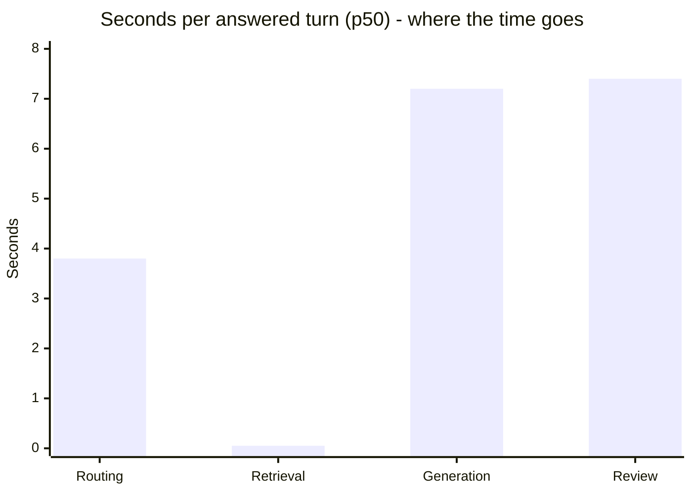
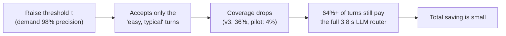
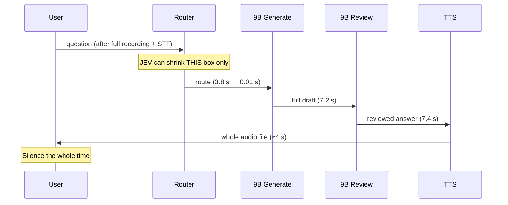
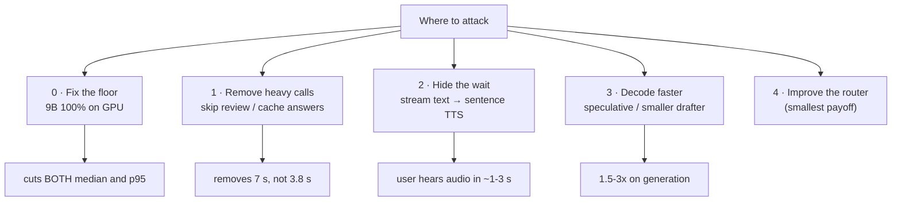

# Why the Decision Models (JEV / Laya) Did Not Remove the Delay

> **Project:** Efficient Voice‑to‑Voice Stack (Demo 2 + Institute Assistant) **Written:** 21 Oct 2026 **Covers:** the Open‑JEV pilot, English v2, English v3 and the Laya "System‑1" router **Evidence used:** your own measurements (`IA/docs/ENGLISH_ROUTER_SPEED.md`, `idea/docs/OPEN_JEV_FAILURE_ANALYSIS_AND_RECOVERY.md`, `idea/FutureWork/01_…` §4.1, `REPORT_12`, `phase0_scripts/out/01_diagnose.txt`) plus published research (linked at the end).

---

## 0. The one‑paragraph answer

The decision model **worked as designed**: it makes a routing decision in **≈9 ms instead of ≈3.8 s**. The delay stayed because **routing was never where most of the time went**. On a normal answered turn, **≈15 of the ≈18 seconds** are spent in two _text‑generating_ 9B LLM calls: **answer generation (≈7.2 s)** and **grounding review (≈7.4 s)**. A decision model **cannot generate text**, so it cannot replace those calls. On top of that, it only answered confidently on **≈36 % of turns** (the other 64 % still went to the LLM router), and the slow tail (p95) comes from **LLM generation variance plus the 9B model spilling onto the CPU**, which a router doesn't touch at all.

In textbook terms this is **Amdahl's Law** (you sped up a small part of the pipeline), made worse by the **risk–coverage trade‑off of selective prediction** (high precision forces low coverage) and the **tail‑latency** problem (p95 belongs to the heaviest, most variable stage).

**The fix:** stop optimising the 3.8 s stage and go after the 14.6 s ones. Put the 9B fully on the GPU, use the decision model to skip the **review** instead of the routing, cache or skip whole answers, stream the answer into TTS, and speed up decoding itself. Details in §5.

---

## 1. First, a picture: where does one turn's time actually go?

Your measured baseline (120 text turns, `qwen3.5:9b`, `01_BASELINE…` §4.1):

| Stage                                     | p50 time                | Share of an 18.7 s answered turn | Can a decision model replace it?     |
| ----------------------------------------- | ----------------------- | -------------------------------- | ------------------------------------ |
| Routing call (9B, `RoutingDecision` JSON) | **3.8 s**               | ~20 %                            | ✅ **Yes**: it's a choice from a menu |
| Retrieval (E5 + BM25 + RRF)               | 0.05 s                  | ~0.3 %                           | ➖ already fast                       |
| Generation call (9B writes the answer)    | **7.2 s**               | ~38 %                            | ❌ **No**: it has to _write prose_    |
| Review call (9B re‑checks the answer)     | **7.4 s**               | ~40 %                            | ⚠️ _Partly_ (see §5.2)               |
| TTS (VITS, whole file)                    | ~3.7–4.5 s _after_ text | (adds to voice)                  | ❌ No                                 |



> [!IMPORTANT] The decision model was aimed at the **smallest** of the three big bars. Even a _perfect_ router (100 % coverage, 0 ms) leaves **≈14.6 s** of generation + review untouched.

---

## 2. The restaurant analogy (the intuition)

Think of your voice agent as a restaurant:

| Restaurant                                            | Your pipeline                                    |
| ----------------------------------------------------- | ------------------------------------------------ |
| **Host** who decides which table/section you go to    | **Router** (intent, category, language)          |
| **Chef** who cooks the meal                           | **Generation** call (writes the grounded answer) |
| **Head chef** who tastes every plate before it leaves | **Review** call (grounding check)                |
| **Waiter** walking the plate to you                   | **TTS** + playback                               |

You hired a **super‑fast robot host** (JEV/Laya). It seats people in 0.01 s instead of 4 s. But:

1. **The kitchen still takes 15 minutes.** Customers barely notice the faster seating. → _Amdahl's Law_
2. **The robot only seats people it is very sure about.** For anyone slightly unusual (Hindi, a follow‑up, a typo, "IIIT Naya Raipur" instead of "IIIT‑NR") it calls the old human host anyway. → _Selective prediction / low coverage_
3. **Some nights the kitchen is randomly slow** (the stove is shared with another restaurant, i.e. the GPU is shared with your desktop, so half the model runs on the CPU). Those nights are the ones customers complain about, and the host has nothing to do with them. → _Tail latency_
4. **A robot host can't cook.** It can only _choose_. → _A decision model can't generate_

That's the whole story. The rest of this note adds the maths and the evidence.

---

## 3. The limitations, one by one

### 3.1 Limitation #1: Amdahl's Law (you optimised the wrong bottleneck)

**The law:** if a fraction **P** of the total time gets **N×** faster, the overall speed‑up is

$$
S_{\text{total}} = \frac{1}{(1-P) + \dfrac{P}{N}} \quad\xrightarrow{N\to\infty}\quad \frac{1}{1-P}
$$

**Your numbers:** routing ≈ 3.8 s of a ≈ 17.2 s median turn, so **P ≈ 0.22**.

- Perfect, infinitely fast router on _every_ turn: $S_{max} = 1/(1-0.22) ≈ \mathbf{1.28\times}$, i.e. 17.2 s → **≈13.4 s**.
- That's the **best possible case**. The user still waits 13+ seconds for text, and longer for audio.

> [!NOTE] Your own failure‑analysis doc computed the same ceiling from a different run: routing was 4.9 s of 15.6 s, which gives at most **≈31.6 % / 1.46×** "before classifier overhead." Either way, **routing alone can never make the turn fast.**

**Intuition:** shaving your commute from 4 min to 0 min doesn't help much if the meeting itself lasts 15 min.

---

### 3.2 Limitation #2: a decision model is "System‑1", so it **chooses** and can't **write**

Decision models like TypeSafe's **Jev**, the open **kyegomez/open‑jev** clone, and **Laya** are built to return a **typed choice** (`Choice`, `Score`, `Noul` / yes‑no) in **one forward pass**. That's why they're fast. TypeSafe's own `jev‑1.13` limitations page lists **"generation"** as something the model doesn't do, and recommends handing over to a generative LLM when prose is needed.

| Kind of work                                    | Shape of the output     | Who can do it fast?                        |
| ----------------------------------------------- | ----------------------- | ------------------------------------------ |
| "Is this knowledge / smalltalk / out‑of‑scope?" | 1 label from a menu     | ✅ Decision model (ms)                      |
| "Which department?"                             | 1 label                 | ✅ Decision model                           |
| "Write the fee answer with exact quotes"        | 100–500 tokens of prose | ❌ Needs an autoregressive LLM              |
| "Is every claim in this answer supported?"      | yes/no **per claim**    | ⚠️ A small _verifier_ model can (see §5.2) |

**Why generation is inherently slow:** an LLM writes **one token at a time**. For _every_ token it has to stream all ~6 GB of weights through memory, so decoding is **memory‑bandwidth bound**. A 9B model writing ~300 tokens just takes seconds. That's the 7.2 s + 7.4 s, and no amount of routing cleverness removes it.

> [!TIP] **Mental model:** a decision model is a **multiple‑choice exam taker**. Your two slowest stages are **essay questions**.

---

### 3.3 Limitation #3: the risk–coverage trade‑off (safe means it often says "I'm not sure")

A selective classifier has a **confidence threshold τ**. Above τ it answers; below τ it **abstains** and the old LLM router runs. This is called **selective prediction** (classification with a reject option), and it obeys one rule:

> **The more precise you demand it to be, the fewer cases it accepts.**



Your gates required **≥98 % accepted precision with zero critical errors**. That's the correct choice for a helpdesk that quotes fees and cutoffs, and it forces low coverage:

| Version                                    | Coverage (turns it actually replaced)         | Median change                 | p95 change                 | Result                   |
| ------------------------------------------ | --------------------------------------------- | ----------------------------- | -------------------------- | ------------------------ |
| Open‑JEV pilot (random‑init, 4.8 M params) | **0 %** live (4 % on dev set, 14 % precision) | −0.56 % (worse)               | +28 %                      | ❌ Reject                 |
| English v2 normalised                      | 12/66 turns (18 %)                            | +2.2 % better                 | not passed                 | ❌ Reject                 |
| **English v3** (MiniLM, calibrated)        | **36.4 %** (+6 % deterministic follow‑ups)    | **−4.11 %** (17.02 → 16.32 s) | **+5.6 %** (43.0 → 45.4 s) | ❌ Reject (latency gates) |

**The expected‑value formula** (from your own failure analysis):

$$
\text{mean saving} \;=\; \underbrace{\text{coverage}}_{0.36} \times \underbrace{\text{routing time}}_{3.8\text{ s}} \;-\; \text{classifier overhead} \;\approx\; 1.4\text{ s} \;(\approx 8\%)
$$

The observed median gain (0.7 s, 4 %) is even smaller than that. That's expected, because the turns the model is _confident_ about tend to be the **easy, cheap** ones (greetings, smalltalk, out‑of‑scope, clean English) that were already fast. The expensive Hindi/Hinglish/follow‑up turns are exactly the ones it defers.

> [!NOTE] v2 is the perfect illustration: it saved **≈5.8 s on each accepted turn** (a big per‑turn win) but accepted only **12/66** turns, so the **overall median moved just 2.2 %**. Big win × rare = small total.

**Why coverage stays low here:**

- **Language:** all JEV shortcuts are English‑only. Hindi/Hinglish (2/3 of your benchmark) always defer.
- **Context:** follow‑ups and pending actions always defer.
- **Brittleness / distribution shift:** "IIIT Naya Raipur" vs "IIIT‑NR" alone flipped a confident _accept_ into a _defer_ (dept prob 0.70 vs 0.95).
- **Small, synthetic data:** the pilot had 1,104 rows but only **64 independent families**, so the model never saw enough real variety to be confident.

---

### 3.4 Limitation #4: the "fallback tax"

On a deferred turn you pay **classifier + full LLM router**. For JEV that extra cost is tiny (~9 ms on CPU). For **Laya** it's an HTTP call to a separate service (~100 ms on a laptop CPU, per a third‑party port) plus a ~2.3 GB model in RAM. With 64 % of turns deferring, a router that is _slower_ or _less confident_ can actually **add** latency on average:

$$
\text{candidate time} = C + (1-A)\,R + D \qquad \text{vs} \qquad \text{baseline} = R + D
$$

(C = classifier cost, A = 1 if accepted, R = router time, D = everything else.) If **A ≈ 0** you're strictly slower.

---

### 3.5 Limitation #5: the tail (p95) belongs to the heavy stages, not to routing

Users don't remember the average turn. They remember the **painfully slow** one. That's the **p95/p99 tail**, and it's dominated by whatever is **largest and most variable**:

| Stage      | p50    | p95     | Spread                                                |
| ---------- | ------ | ------- | ----------------------------------------------------- |
| Routing    | 3.80 s | 4.59 s  | **±0.8 s** (stable)                                   |
| Generation | 7.18 s | 13.36 s | **±6 s**                                              |
| Review     | 7.41 s | 13.45 s | **±6 s** (one v2 turn: **32.1 s** vs 9.0 s baseline!) |

So when JEV v3's p95 went **up** by 2.4 s, it wasn't the 9 ms classifier's fault. Your own report notes the regression **"mainly appeared in generation/review, not classifier execution."** The router can remove at most ~4.6 s from the tail, while review alone swings by 20+ s.

**Why the heavy stages swing so much on your machine:**

```
From 01_diagnose.txt (today):
  Free VRAM: 4979 MiB
  qwen3.5:9b needs ~6758 MiB + KV cache
  >> the 9B will SPILL to CPU.
Past runs recorded Ollama CPU/GPU splits of 52%/48% and 32%/68%.
```

When part of a model runs from system RAM, every token has to cross the PCIe bus. Decode speed is set by the _slowest_ memory, so even a 20–50 % offload can roughly **halve tokens/s**. How much spills depends on what else is using the GPU at that moment (Firefox, Steam, the desktop compositor…), and that's exactly the random "slow night" that creates a fat tail.

> [!WARNING] **Measurement trap:** a 0.7 s improvement buried in ±10–20 s of run‑to‑run noise is like **weighing a feather on a truck scale**. With ~20–200 paired turns, the p95 can come out worse purely by chance. Your E1 tooling (paired bootstrap, `REPORT_12`) caught exactly this "median better, p95 worse" pattern and correctly said **REJECT**.

This is the core idea of Dean & Barroso's _"The Tail at Scale"_: tail latency comes from **variability** in the slowest components. To fix it you have to **reduce or hide that variability**. Speeding up a stage that was already fast and stable doesn't help.

---

### 3.6 Limitation #6: every stage is serial, and in a voice app the user hears **all** of them

`01_BASELINE` §2: _"Every arrow is sequential. Nothing streams."_



For a voice agent the metric that matters is **time to first audio**: how long until the user hears _anything_. Production voice stacks aim for **≈0.5–0.8 s** by **overlapping** stages (stream tokens → cut at sentence boundaries → synthesise sentence 1 while the LLM writes sentence 2). In your pipeline the user hears nothing until **every** stage has completely finished, so a 3.8 s saving on one box barely changes the silence.

---

## 4. Summary table: name the limitation

| #   | Limitation (proper name)                           | One‑line intuition                             | Evidence in your project                                   |
| --- | -------------------------------------------------- | ---------------------------------------------- | ---------------------------------------------------------- |
| 1   | **Amdahl's Law** / wrong bottleneck                | Faster seating, same kitchen                   | Routing 3.8 s of 17.2 s, ceiling ≈1.28×                    |
| 2   | **Decision ≠ generation** (System‑1 limit)         | Multiple‑choice model facing essay questions   | Gen 7.2 s + review 7.4 s untouchable                       |
| 3   | **Risk–coverage trade‑off** (selective prediction) | To be 98 % right, it must often say "not sure" | Coverage 0 % → 18 % → 36 %                                 |
| 4   | **Fallback tax**                                   | Ask the robot, then ask the human anyway       | Deferred turns pay C + R                                   |
| 5   | **Tail latency** is owned by variable heavy stages | Random slow nights in the kitchen              | p95 ↑ from review (32 s vs 9 s), GPU spill                 |
| 6   | **Serial, non‑streaming pipeline**                 | Waiter waits until all courses are cooked      | No token / TTS streaming in Demo 2 path                    |
| +   | **Distribution shift / weak data**                 | Robot trained on 64 kinds of customers         | "IIIT Naya Raipur" vs "IIIT‑NR" flip; pilot 14 % precision |

---

## 5. What can be done: ordered by how much delay it actually removes

> [!TIP] **Golden rule:** a technique only reduces latency if it **removes, shortens, or overlaps** a _big_ stage on a _large fraction_ of turns. Rough expected impact ≈ **(seconds removed per turn) × (fraction of turns it applies to)**.



### 5.0 Fix the floor first: make the 9B run 100 % on the GPU (roadmap **A1**)

**Why first:** this is the single biggest lever on the **tail**, it speeds up _all three_ LLM calls at once, and it costs nothing.

- Free VRAM: move the desktop/browser/Steam to the iGPU (`phase0_scripts/03_free_vram_A1.sh`), then confirm `ollama ps` shows **`100% GPU`**.
- Or use a smaller footprint you already have: `hf.co/unsloth/Qwen3.5-9B-GGUF:Q3_K_M` (5.6 GB) or `qwen3.5:4b` (3.4 GB) for routing/review.
- Keep the model resident (`OLLAMA_KEEP_ALIVE=-1`, A3). Your first turn showed **11.2 s of model loading** inside "routing".
- Keep `num_predict` capped (A8) so a runaway generation can't create a 40 s turn.

**Expected:** decode tokens/s roughly ×1.5–2 when going from a ~50 % CPU split to full GPU, so generation + review shrink together and p95 tightens.

### 5.1 Re‑aim the decision model at a bigger target: gate the **review** (roadmap **B1**)

Your decision model is good at **yes/no**. The question "_is this answer fully supported by the quoted evidence?_" is a yes/no question, and it guards a **7.4 s** stage that runs on **every** answered turn (and its tail reaches 13–32 s).

- Use a **small grounding/NLI checker** such as **MiniCheck** (770M–7B; matches GPT‑4 on document‑grounded fact‑checking at ~400× lower cost) on each claim + quoted span.
- **Low‑risk & supported** → skip the 9B review. **Uncertain / critical (fees, cutoffs)** → run the 9B review as today.
- You already have the safety pieces: deterministic verbatim‑quote validation (`evidence.py`), critical‑policy rules, and A2 (skip review on verified cache hits).

**Back‑of‑envelope:** skipping review on even 50 % of answered turns saves ≈ 0.5 × 7.4 ≈ **3.7 s**, which is more than a _perfect_ router could ever save, and it also trims the tail.

### 5.2 Skip the whole answer when you've answered it before (roadmap **B6**)

- **Pre‑verified FAQ bank:** generate and human‑verify answers for the top ~100 helpdesk questions offline. Serve them in milliseconds.
- **Semantic cache:** match a new question to a stored one by embedding similarity. Semantic caches commonly intercept a large share of FAQ‑style traffic.
  - ⚠️ Danger: **false hits** ("fees for B.Tech" ≠ "fees for M.Tech"). Use the **decision model as the cache‑hit verifier** ("same question? same slots? same KB release?"). That's a perfect job for a typed yes/no model.
- Your exact‑repeat cache already shows the effect: **25.9 s → 12.7 s** locally (3 → 2 calls). A semantic/FAQ hit can go to **≈0 LLM calls**.

### 5.3 Hide the remaining time: stream (roadmap **A5 → B7 → C2**, **A4**)

You can't make a 9B write 300 tokens instantly, but you _can_ make the user **hear something** after the first sentence:

1. **Instant acknowledgement** (A4, done): a pre‑rendered "Let me check that…" right at end of turn.
2. **Stream LLM tokens** → cut at sentence boundaries (`clause_segmenter.py` exists) → **synthesise sentence 1 while the LLM writes sentence 2** (A5 `synthesize_stream` exists).
3. **Sentence‑level verification** (C2): verify and speak sentence 1 as soon as it's supported, instead of waiting for the whole answer + whole review. This keeps your "never speak an unverified fact" rule.

**Expected:** total compute stays similar, but **time‑to‑first‑audio** drops from "everything + TTS" to roughly "first sentence + first TTS chunk". That's the number users _feel_.

### 5.4 Make decoding itself faster (roadmap **C1**, **C3**, **A7**)

- **Prompt‑lookup (n‑gram) speculative decoding** (llama.cpp / llama‑server): RAG answers copy a lot of text verbatim from the retrieved evidence. The model "guesses ahead" by copying from the prompt and verifies many tokens in one pass. **No extra VRAM, lossless output, often ~1.5–3× on generation.** It's a natural fit for your quote‑heavy answers.
- **Small distilled drafter** (C3): a 1–3B model trained on your _verified_ answers drafts, and the 9B escalates only when unsure. Your `distillation/` Stage‑0 pipeline + certificate already exist.
- **Grammar penalty** (A7): the giant quote‑enum grammar made evidence tokens ~2.6× slower. The integer `span_index` change is shipped, so measure it (REPORT_05 L1).
- **Merge redundant calls:** generation and review "produce the answer twice". Test whether a single structured call (answer + per‑claim evidence indices) plus the deterministic quote validator + a small checker can replace the second 9B pass on non‑critical turns.

### 5.5 If you still want the router to help (smallest payoff, but cheap)

- Start from **pretrained multilingual encoders** (mmBERT‑small, multilingual MiniLM, SetFit) so Hindi/Hinglish can be covered, not just English.
- Train on **many independent question families** (hundreds, not 64), including misspellings, Romanised Hindi, aliases ("IIIT Naya Raipur", "Triple IT NR").
- Recalibrate (temperature scaling) on project data. Laya is reported as _under‑confident_, which needlessly lowers coverage.
- **Overlap instead of replace:** start retrieval on the raw English text _in parallel_ with the router, so a correct guess saves the wait.
- Remember the ceiling: even at 100 % coverage the router saves ≤ ~3.8 s. **Use it as a helper for 5.1/5.2**, not as the main latency fix.

### 5.6 Measure it so the result is believable

- Always record **GPU residency** (`ollama ps`) with each run. A run with CPU spill isn't comparable to one without.
- Report **per‑stage p50 and p95** (routing / generation / review / TTS), not just the total.
- Use ≥3 paired trials and your paired bootstrap (`stats.py`). Judge **median and p95**.
- For voice, add **time‑to‑first‑audio** as a headline metric.

---

## 6. Expected impact at a glance (rough, to prioritise, not promises)

| Action                                  | Seconds removed per affected turn     | Fraction of turns affected | Helps p95?    | Effort               |
| --------------------------------------- | ------------------------------------- | -------------------------- | ------------- | -------------------- |
| Perfect router (theoretical max)        | ≤ 3.8                                 | ≤ 100 %                    | barely        | done/high            |
| JEV v3 as measured                      | 0.7 (median)                          | 36 %                       | ❌             | done                 |
| **9B fully on GPU (A1)**                | ~5–8 (all 3 calls faster)             | ~100 %                     | ✅✅            | low                  |
| **Risk‑gated review (B1)**              | ~7.4                                  | 30–60 % of answered        | ✅             | medium               |
| **FAQ bank / semantic cache (B6)**      | ~14–18 (whole turn)                   | repeat/FAQ share           | ✅             | medium               |
| **Streaming + sentence TTS (A5/B7/C2)** | perceived: ~10+ s earlier first audio | ~100 %                     | ✅ (perceived) | medium               |
| Prompt‑lookup speculative decoding (C1) | ~2–4 on generation                    | answered turns             | ✅             | medium (engine swap) |

_Numbers are estimates derived from your measured stage times; each needs its long test (see REPORT_05/06/07) before you claim it._

---

## 7. How to say this in your report or viva

> "We integrated a local typed‑decision router (Open‑JEV clone → English v3 MiniLM, and a Laya adapter). It reduced the routing decision from ≈3.8 s to ≈9 ms and, at a 98 %‑precision operating point, replaced the LLM router on 36 % of turns. End‑to‑end latency improved only 4 % at the median and regressed 5.6 % at p95, failing our promotion gates. The cause is structural, not a bug. Routing is ≈20 % of turn time (Amdahl's ceiling ≈1.28×). The dominant ≈15 s comes from two autoregressive 9B calls (generation and review) that a decision model cannot replace. High‑precision selective prediction limits coverage, and the p95 tail is driven by generation/review variance under partial CPU offload. Our next steps therefore target the dominant stages: full‑GPU residency, risk‑gated review with a small grounding checker, a verified FAQ/semantic cache, and streamed sentence‑level verification + TTS."

---

## 8. Glossary (plain words)

| Term                                | Meaning                                                                        |
| ----------------------------------- | ------------------------------------------------------------------------------ |
| **Decision model / System‑1 model** | A model that picks from given options in one pass (fast, can't write text)     |
| **Router**                          | The step deciding _what kind_ of question this is and where it should go       |
| **Coverage**                        | % of turns where the fast model actually answered instead of deferring         |
| **Accepted precision**              | Of the turns it _did_ answer, how many were right                              |
| **Abstain / defer / fallback**      | "Not sure" → hand the turn to the old (slow) path                              |
| **p50 / p95**                       | Median turn time / the time that 95 % of turns stay under (the "bad‑day" time) |
| **Amdahl's Law**                    | Overall speed‑up is capped by the part you _didn't_ speed up                   |
| **Autoregressive decoding**         | Writing one token at a time. Each token needs a full pass over the weights     |
| **Memory‑bandwidth bound**          | Speed is limited by how fast weights move from memory, not by compute          |
| **CPU offload / spill**             | Model too big for VRAM → some layers run from system RAM → much slower         |
| **Time to first audio (TTFA)**      | Delay from "user stopped talking" to "user hears the first sound"              |
| **Speculative decoding**            | Guess several tokens cheaply, verify them in one pass of the big model         |
| **Semantic cache**                  | Reuse a stored answer when a new question _means_ the same thing               |

---

## 9. Sources

**Your project (measured):**

- `code/Institute-voice-agent/institute-assistant/docs/ENGLISH_ROUTER_SPEED.md`: v3 results (36.36 % coverage, 17.018 → 16.318 s, p95 43.0 → 45.4 s, tail in generation/review)
- `code/Institute-voice-agent/institute-assistant/docs/ENGLISH_ROUTER_EXTENDED_RUN.md`: v2 runs, alias mismatch, GPU‑pressure interruption
- `idea/docs/OPEN_JEV_FAILURE_ANALYSIS_AND_RECOVERY.md`: pilot failure, saving formula, 31.6 % ceiling
- `idea/FutureWork/01_BASELINE_AND_CURRENT_ARCHITECTURE.md` §4.1: stage timings (3.8 / 7.2 / 7.4 s)
- `idea/FutureWork/REPORT_12_EVALUATION_AND_BENCHMARKING.md`: paired bootstrap, p95 REJECT
- `idea/FutureWork/phase0_scripts/out/01_diagnose.txt`: VRAM 4979 MiB free → 9B spills to CPU
- `code/Institute-voice-agent/institute-assistant/docs/LAYA_SYSTEM1.md`: Laya integration

**External research:**

- Amdahl's Law: https://en.wikipedia.org/wiki/Amdahl%27s_law
- Dean & Barroso, _The Tail at Scale_, CACM 2013: https://research.google/pubs/the-tail-at-scale/
- Geifman & El‑Yaniv, _SelectiveNet_ (risk–coverage), ICML 2019: https://proceedings.mlr.press/v97/geifman19a.html
- Guo et al., _On Calibration of Modern Neural Networks_, ICML 2017: https://proceedings.mlr.press/v70/guo17a.html
- TypeSafe Jev docs (confidence, jev‑1.13 limitations incl. "generation"): https://docs.typesafe.ai/confidence, https://docs.typesafe.ai/model-jaggedness/jev-1.13
- kyegomez/open‑jev (random‑init reconstruction): https://github.com/kyegomez/open-jev
- Laya System‑1 engine: https://github.com/NandhaKishorM/laya
- Chen et al., _FrugalGPT_ (savings depend on the fraction of queries that skip the big model): https://arxiv.org/abs/2305.05176
- RouteLLM: https://github.com/lm-sys/RouteLLM
- Tang, Laban, Durrett, _MiniCheck_ (small grounding checker, GPT‑4‑level, ~400× cheaper): https://arxiv.org/abs/2404.10774
- GPTCache (semantic caching): https://github.com/zilliztech/GPTCache
- Leviathan et al., _Fast Inference via Speculative Decoding_: https://arxiv.org/abs/2211.17192
- Prompt‑lookup decoding: https://github.com/apoorvumang/prompt-lookup-decoding
- Ollama FAQ (GPU/CPU split via `ollama ps`): https://github.com/ollama/ollama/blob/main/docs/faq.md
