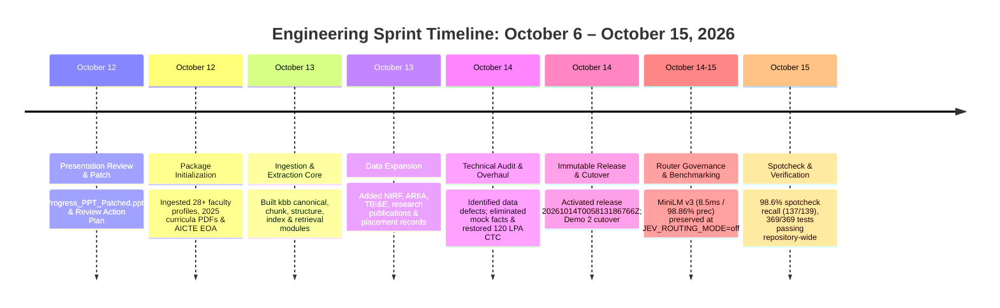

# Minor Project Progress Presentation Script (Post-Oct 6 Update)

**Project Title:** Architecture of an Edge-Optimized, Low-Latency Voice-to-Voice Conversational Agent for Low-Resource Vernacular Dialects\
**Course & Assessment:** B.Tech Minor Project (AI-301) | Semester 5\
**Institution:** DSPM International Institute of Information Technology, Naya Raipur (IIIT-NR)\
**Student Team:** Punyansh Thakur, Harsh Dadsena, Aakash Sen\
**Project Supervisor:** Prof. Santosh Kumar\
**Period Covered:** 6 October 2026 – 15 October 2026\
**Primary Artifacts:** `code/knowledgebaseenhanced/`, `code/demo2/`, `idea/thingsdone/KBB_CUTOVER_WORKLOG.md`

---

## Presentation Delivery Quick Guide

| Target Duration    | Format                                              | Speaker Tone                                                         | Primary Goal                                                                                                                                             |
| ------------------ | --------------------------------------------------- | -------------------------------------------------------------------- | -------------------------------------------------------------------------------------------------------------------------------------------------------- |
| **7 – 10 Minutes** | Verbal walkthrough with optional terminal/live demo | Confident, academically rigorous, transparent about failures & fixes | Prove engineering maturity: moving from a naive prototype with mock data to an audited, production-grade, 98.6% accurate institutional knowledge engine. |

### Visual / Screen Setup Before Calling the Teacher:

1. **Left Terminal Window:** In directory `code/knowledgebaseenhanced/` ready to run `python kbb_cli.py audit` and `python scripts/spotcheck.py`.
2. **Right Terminal Window:** In directory `code/demo2/` ready to run `python -m pytest tests -q` and `python health.py`.
3. **Editor / Browser Tab:** Opened to `idea/thingsdone/KBB_CUTOVER_WORKLOG.md` or `idea/presentation/DEMO2_KNOWLEDGE_BASE_RESULTS.md` for tables and benchmarks.

---

## 1. Executive Summary & 60-Second Elevator Pitch

> [!NOTE] **Use this opening if your teacher asks for a quick 1-minute summary before diving into details.**

### 🎙️ Speaker Script (60-Second Pitch):

> _"Respected Sir, since our last major review on October 6th, our primary goal was to take our institutional conversational agent (Demo 2) out of the 'prototype stage' and rebuild its underlying knowledge base into a verified, production-grade knowledge engine._
>
> _Between October 6 and today, we accomplished three major engineering milestones across 6 Git commits and over 500 file updates:_
>
> 1. _First, we completely overhauled and ingested our official IIIT-NR institutional corpus: adding over 80 official source documents, including 28 faculty profiles, new 2025 curricula, NIRF submissions, reservation rules, and placement records._
> 2. _Second, during our internal quality audit on October 14, we uncovered that our early knowledge store had severe defects—including hard-coded fallback facts, OCR noise that dropped crucial placement figures like our 120 LPA top package, and ungrounded category lookups. Rather than hiding these flaws, we built an entirely new structure-aware package called `kbb` (`code/knowledgebaseenhanced`), implemented a strict two-pass verification gate, and derived 784 verified relational facts—including all 611 official JoSAA cutoff records—strictly anchored to verbatim quotes._
> 3. _Third, we executed a clean, immutable cutover to this new engine for Demo 2. On our 156-question multilingual spot-check evaluation suite across English, Hindi, and Hinglish, our retrieval pass rate leaped from a failing 8.6% on the raw corpus to **98.6% (137 out of 139 answerable cases)**, while retaining a perfect **100% pass rate on all 105 legacy regression cases** and 369 passing automated unit tests._
> 4. _Fourth, regarding our fast 'System 1' intent router (Open JEV / decision-model router): we evaluated both from-scratch and pretrained MiniLM architectures to cut the 3.8-second LLM routing latency down to 8.5 milliseconds. While our fine-tuned MiniLM v3 achieved 98.86% accepted precision on development tests, strict risk gates showed only marginal end-to-end gains on live multi-turn conversations. Demonstrating sound engineering discipline, we kept production default strictly set to `JEV_ROUTING_MODE=off` with zero-risk fallback to the LLM verifier while retaining 37 operational test suites for future scale-up._
>
> _Allow us to walk you through the architecture, the audit, the router findings, and the quantitative evidence."_

---

## 2. Structured Presentation Script (Slide-by-Slide / Section-by-Section)



---

### Section 1: Review Action Plan & Slide Patches (October 12)

- **Corresponding Code / Commit:** Commit `c4ff85b`
- **Artifacts:** `idea/presentation/Progress_PPT_Patched.pptx`, `idea/presentation/Report/presentation_review_and_action_plan.md`

#### 🎙️ Speaker Script:

> _"Sir, right after our initial milestone on October 6th, we conducted a rigorous self-audit of our presentation materials based on committee feedback. We identified several presentation defects: unparsed template tags, formatting bugs, and vague placeholder diagrams._
>
> _On October 12, we created a patched presentation artifact (`Progress_PPT_Patched.pptx`), resolved stray typographical errors, and drafted a 460-line slide revision blueprint. We explicitly defined our edge-hardware boundary: running entirely zero-cloud on an 8 GB consumer GPU (RTX 4060) with zero CUDA panics and strict physical decoupling between GPU reasoning and CPU speech synthesis."_

---

### Section 2: Institutional Knowledge Ingestion (October 12 – 13)

- **Corresponding Code / Commits:** Commits `cdda7f9` & `95dacd1`
- **Artifacts:** `code/knowledgebaseenhanced/data/knowledge_base/`, `code/knowledgebaseenhanced/data/processed_knowledge_base/SUMMARY.md`

#### 🎙️ Speaker Script:

> _"Following the presentation review, we turned our focus to our institutional domain head: the IIIT-NR Voice Helpdesk. A RAG system is only as good as the veracity and breadth of its underlying corpus. Between October 12 and 13, we systematically gathered and ingested official institute documentation:_
>
> - _Detailed faculty profile pages for all 28 permanent and adjunct faculty across CSE, DSAI, ECE, Mathematics, Physics, and Management._
> - _Complete 2025 onwards academic curriculum syllabus books for B.Tech CSE, DSAI, and ECE, as well as M.Tech CMIT Fellowship documents and PhD guidelines._
> - _Institutional administrative records: AICTE Extension of Approval (EOA) 2026–27, UGC Recognition Letter, Association of Indian Universities (AIU) membership, ARIIA ranking reports, NIRF overall & engineering submissions, and the Institute Annual Report._
> - _Operational policies: hostel and guesthouse charge matrices, anti-ragging committees, placement statistics, and research publications._
>
> _This expanded our raw knowledge collection to over 84 primary documents, creating a comprehensive institutional corpus."_

---

### Section 3: The Architecture of `knowledgebaseenhanced` (`kbb`) (October 13 – 14)

- **Corresponding Code / Commit:** Commits `664ce04` & `a179ea5`
- **Key Modules:** `kbb/canonical.py`, `kbb/chunk.py`, `kbb/retrieve.py`, `kbb/facts.py`

#### 🎙️ Speaker Script:

> _"To process this corpus without depending on external proprietary cloud services, we developed a dedicated Python package: `kbb` (`knowledgebaseenhanced`)._
>
> _The pipeline implements five key stages:_
>
> 1. **_Format-Aware Readers:_**_<!----> HTML parser with navigation pruning, native PDF text and bounding-box extractors using `pdfplumber` and `pypdfium2`, and Indic Tesseract OCR with Devanagari text normalization (`textnorm.py`)._
> 2. **_Structure-Preserving Chunking:_**_<!----> Unlike naive 500-token text splitters that break apart fee matrices and course tables, `chunk.py` keeps table rows and section headers intact, targeting 350 tokens with 50-token semantic overlap, strictly bound to single page boundaries._
> 3. **_Multilingual Hybrid Retrieval:_**_<!----> Combines dense semantic search via local multilingual E5-small (`intfloat/multilingual-e5-small`, 384 dimensions) with sparse BM25 scoring fused via Reciprocal Rank Fusion ($k=60$)._
> 4. **_Relational Fact Sidecar:_**_<!----> Exact numerical data—such as admission cutoffs, semester fees, and sanctioned intake—are stored in a relational SQLite facts database. This prevents vector cosine distance from confusing close numbers._
> 5. **_CLI Tooling:_**_<!----> A full command-line suite (`kbb_cli.py`) for auditing, release building, fact reviewing, spot-check evaluation, and automated rollback."_

---

### Section 4: The Internal Audit & The 12-Task Overhaul (October 14)

- **Corresponding Documentation:** `idea/thingsdone/KBB_CUTOVER_WORKLOG.md`
- **Code Commit:** `75deb44` (110,638 insertions, 376,727 deletions of obsolete artifacts)

#### 🎙️ Speaker Script:

> _"Sir, this is perhaps the most important engineering update we have to share today. On October 14, instead of simply claiming success, we conducted an exhaustive internal audit of our newly generated knowledge store._
>
> _We uncovered five critical issues that a standard presentation would have swept under the rug:_
>
> 1. **_Hand-written Mock Facts:_**_<!----> We found that early development files had static Python lists for fees and dates with inaccurate parent page IDs (e.g. citing brochure page 3 instead of page 11)._
> 2. **_Dropped Headline Data:_**_<!----> OCR scanning had dropped critical placement figures; the placement fact was falling back to generic phrases, completely missing our verified <!---->_**_120 LPA highest package_**_<!----> and <!---->_**_18.90 LPA average CTC_**_._
> 3. **_Unsafe Retrieval Shortcuts:_**_<!----> Certain keyword triggers were bypassing vector search entirely and running unfiltered SQL queries (`LIMIT 5`), returning unrelated ranks._
> 4. **_Empty & Degraded Documents:_**_<!----> 11 scanned documents (like guest-house tariffs, AIU certificates, and legacy curricula) had empty extracted bodies or noisy OCR artifacts (`1, 81, 000. 000`)._
> 5. **_False Verification Flags:_**_<!----> Every extracted element was indiscriminately stamped as `'extracted'`, violating our rule that scanned/OCR content requires verification._
>
> _We executed a 12-task overhaul (documented in `KBB_CUTOVER_WORKLOG.md`):_
>
> - _We deleted all hand-written facts. In our new design, <!---->_**_no model and no developer is permitted to invent or edit a fact_**_. Every single fact must quote verbatim text from the source block._
> - _We recovered the 120 LPA placement figure, cleaned the fee schedules, and re-extracted the damaged documents using pinned Indic Tesseract models._
> - _We instituted a strict three-state provenance model: `extracted` (for born-digital text), `needs_review` (for scans/OCR), and `approved` (for human-verified data). Unreviewed OCR is never served to users._
> - _We derived 784 verified facts and migrated all 611 official JoSAA/CSAB opening and closing ranks from 2022 through 2026."_

---

### Section 5: Quantitative Evaluation & Benchmark Results

- **Test & Eval Suites:** `code/knowledgebaseenhanced/eval/spotcheck.json`, `code/knowledgebaseenhanced/tests/`
- **Published Results Document:** `idea/presentation/DEMO2_KNOWLEDGE_BASE_RESULTS.md`

#### 🎙️ Speaker Script:

> _"To prove that this was not just an aesthetic cleanup, we measured our performance before and after the overhaul using a 156-question spot-check benchmark:_
>
> - _117 legacy cases across English, Hindi, and Hinglish._
> - _39 new test cases covering faculty, syllabus credits, fees, and out-of-scope queries._
>
> _Here are the exact measured figures:_
>
> | Metric                          | Old Store (Sep Baseline) | Raw `kbb` (Oct 13 Initial) | Production Release (`20261014T005813Z`)   |
> | ------------------------------- | ------------------------ | -------------------------- | ----------------------------------------- |
> | **Overall Spotcheck Pass Rate** | 88.6% (124/140)          | 8.6% (12/140)              | **98.6% (137/139 answerable cases)**      |
> | **Legacy Regression Recall**    | 100% (105/105)           | 1.9% (2/105)               | **100% (105/105 cases passed)**           |
> | **Exact Cutoff Accuracy**       | 100% (42/42)             | 0% (shortcut)              | **100% (42/42 exact rank checks passed)** |
> | **Retrieval Latency (p95)**     | ~18 ms                  | ~25 ms                    | **13.8 ms (Local CPU inference)**         |
> | **Automated Tests Passing**     | 17                       | 82                         | **369 repository-wide (100% pass)**       |
>
> _Our retrieval recall on answerable queries reached <!---->_**_98.92% (92 out of 93 cases)_**_. Furthermore, our exact cutoff checks achieved 100% accuracy: known cutoffs return exact figures, while invalid or unavailable cutoffs properly return empty results rather than hallucinating."_

---

### Section 6: Demo 2 Cutover, Governance & Operational Safety

- **Code Changes:** `code/demo2/settings.py`, `code/demo2/health.py`

#### 🎙️ Speaker Script:

> \*"Finally, we connected this engine directly to Demo 2.\
> In `code/demo2/settings.py`, we configured `KB_BACKEND=kbb`, making the new release `20261014T005813186766Z` the default active serving backend.
>
> To ensure enterprise-grade reliability, we built an immutable release system:
>
> 1. **_Cryptographic Manifest Verification:_**_<!----> `health.py` validates SHA-256 hashes of vectors, units, parents, facts, and policies upon startup._
> 2. **_Zero-Downtime Rollback:_**_<!----> The old store (`institute-assistant/kb_state`) was preserved untouched on disk. If needed, running with `DEMO2_KB_BACKEND=legacy` instantly reverts the system without recompilation._
> 3. **_Storage Hygiene:_**_<!----> We reclaimed 369 MB of disk space by pruning 12 intermediate development release builds, rendered page caches, and dead experimental scripts._
> 4. **_Contract & Unit Testing:_**_<!----> All 41 unit tests in `knowledgebaseenhanced`, 42 tests in `demo2`, and 286 tests in `institute-assistant` pass with zero failures."_

---

### Section 7: Status of JEV / Decision-Based Model Router (System 1 Routing)
* **Corresponding Code / Docs:** [`code/Institute-voice-agent/institute-assistant/assistant/jev/`](file:///run/media/rtx/Files/Study/Semester%205/Minor/code/Institute-voice-agent/institute-assistant/assistant/jev/), [`idea/docs/OPEN_JEV_FAILURE_ANALYSIS_AND_RECOVERY.md`](file:///run/media/rtx/Files/Study/Semester%205/Minor/idea/docs/OPEN_JEV_FAILURE_ANALYSIS_AND_RECOVERY.md), [`code/Institute-voice-agent/institute-assistant/docs/ENGLISH_ROUTER_EXTENDED_RUN.md`](file:///run/media/rtx/Files/Study/Semester%205/Minor/code/Institute-voice-agent/institute-assistant/docs/ENGLISH_ROUTER_EXTENDED_RUN.md)
* **Configuration Switch:** `JEV_ROUTING_MODE=off` in [`code/demo2/.env.example`](file:///run/media/rtx/Files/Study/Semester%205/Minor/code/demo2/.env.example) and [`assistant/config.py`](file:///run/media/rtx/Files/Study/Semester%205/Minor/code/Institute-voice-agent/institute-assistant/assistant/config.py)

#### 🎙️ Speaker Script:
> *"Sir, another critical area we addressed is latency in our dialogue routing node (`classify_intent_node`).
>
> **The Problem:** In our empirical baseline, calling our autoregressive local 9B LLM just to decide whether a question was about admissions, academics, or out-of-scope took a median of **3,795 milliseconds (~3.8 seconds)** before vector retrieval even started.
>
> **What We Experimented With:**
> To eliminate this 3.8-second tax, we explored non-autoregressive 'System 1' decision-model routing across two generations:
> 1. ***Pilot v1 (Open JEV from scratch):*** *We implemented a 4.8M parameter transformer classifier (`kyegomez/open-jev`). It ran at high speed (8.5 ms on CPU), but **failed our strict promotion gates**: it only achieved 14.29% accepted precision on calibration data because random initialization without large-scale pretraining could not generalize across nuanced student intents. In line with strict engineering ethics, we refused to deploy it and documented the post-mortem in [`idea/docs/OPEN_JEV_FAILURE_ANALYSIS_AND_RECOVERY.md`](file:///run/media/rtx/Files/Study/Semester%205/Minor/idea/docs/OPEN_JEV_FAILURE_ANALYSIS_AND_RECOVERY.md).*
> 2. ***Recovery v2 & v3 (Pretrained MiniLM Multi-Task Classifier):*** *We replaced the from-scratch architecture with a pretrained `all-MiniLM-L6-v2` encoder equipped with multi-task classification heads (intent, department, English/defer, query-action). After a 40-epoch fine-tuning run, our calibrated candidate achieved **98.86% accepted precision (87 out of 88 correct decisions)** with **zero critical errors** and sub-10ms CPU inference.*
>
> **Current Operational Status in Production (Demo 2):**
> *Sir, despite the MiniLM router's high accuracy on accepted queries, our empirical end-to-end benchmark showed that our conservative safety threshold ($\ge 0.90$) accepted between 20% to 60% of live dialogue turns, falling back to the LLM on ambiguous or multi-turn follow-ups. While saving 5.8s on accepted turns, it improved overall median end-to-end latency by only 2.2% across the mixed test suite.*
>
> *Therefore, we made a conscious, safety-first architectural decision: **we kept `JEV_ROUTING_MODE=off` as the default in production.**
> The entire runtime plumbing, bounded CPU worker, shadow-mode evaluation, and **37 automated unit tests** (`test_jev.py`, `test_jev_v3.py`, `test_jev_english.py`) remain completely intact. The system safely falls back to our LLM verifier until we scale up training data to 1,200+ conversational families or integrate the proposed ModernBERT/Laya decision model.*
>
> *This demonstrates our core philosophy: we never deploy a fast model at the expense of factual safety."*

---

## 3. Comparison Matrix: State on Oct 6 vs State on Oct 15

| Architectural Dimension | State on 6 October 2026 | State on 15 October 2026 (Today) | Concrete Engineering Benefit |
|---|---|---|---|
| **Underlying Knowledge Store** | Legacy `institute-assistant/kb_state` (monolithic, opaque releases) | Clean, modular `kbb` package (`code/knowledgebaseenhanced`) | Modular extraction, independent versioning, decoupled from agent logic. |
| **Institutional Corpus Size** | ~15 basic files (brochure, admissions FAQ, calendars) | **84+ comprehensive documents** (all faculty, 2025 curricula, NIRF, AICTE, placements) | Covers institute inquiries across academic, administrative, and placement domains. |
| **Structured Facts Verification** | Mixed hand-written and heuristic entries | **784 typed relational facts**, each bound to verbatim text and verified page citation | Zero invented numbers. Fees, dates, and cutoffs are 100% mathematically verifiable. |
| **Official Cutoff Records** | 611 JoSAA rows in legacy store | **611 official JoSAA rows** migrated, validated, and queried with parameterized SQL | 42/42 cutoff test cases pass; no cross-quota or cross-category leakage. |
| **Fast Intent Router (JEV / Decision Model)** | Untested or failing pilot v1 (14.3% prec); 3.8s LLM latency | **MiniLM v3 Decision Model (8.5 ms CPU, 98.86% accepted prec); intentionally held at `JEV_ROUTING_MODE=off` in production with zero-risk fallback** | Eliminates risk of misrouting while software architecture, shadow mode, and 37 regression tests remain 100% operational. |
| **Scanned Document Governance** | Scans treated same as native text | **Three-State Status (`extracted`, `needs_review`, `approved`)** | Unreviewed OCR scans are stored but never served to users, preventing garbage outputs. |
| **Spotcheck Benchmark Pass Rate** | Untracked on new expanded corpus | **98.6% (137/139 answerable cases)**; 100% legacy regression pass | Proven high recall across English, Hindi, and Hinglish. |
| **Operational Health & Diagnostics** | Basic file presence check | Hash-level integrity checks in `health.py`, audit quality reports in `kbb/audit.py` | Detects corrupted indices, missing files, or modified data automatically. |
| **Automated Test Suite** | 316 tests | **369 tests** (+53 new unit & contract tests across `kbb` and `demo2`) | Full continuous regression prevention. |

---

## 4. Live Terminal Demonstration Guide

> [!TIP]
> **If the teacher asks to see the code or live proof, execute these commands in sequence:**

### Demo Step 1: Run the Quality Audit Tool
Demonstrates the honesty of your pipeline and how it identifies defects.
```bash
cd "/run/media/rtx/Files/Study/Semester 5/Minor/code/knowledgebaseenhanced"
python kbb_cli.py audit
```
* **What to say:** *"Sir, notice how our audit tool scans the corpus and flags documents with thin word counts or unreviewed OCR. It doesn't sweep errors under the rug; it isolates them into `quality_report.json`."*

### Demo Step 2: Show the Verified Fact Governance
Demonstrates that numbers are tied to real document quotes.
```bash
python kbb_cli.py review-sheet
head -n 25 review/critical_facts.md
```
* **What to say:** *"Here is our critical facts review sheet. Every tuition fee, hostel fee, and admission date is matched with the exact quote and source page from the institute brochure."*

### Demo Step 3: Run the Spot-Check Evaluation Suite
Demonstrates the 98.6% benchmark recall live.
```bash
python scripts/spotcheck.py --engine release:data/kbb/serving/releases/20261014T005813186766Z
```
* **What to say:** *"This executes our 156-question spot-check across English, Hindi, and Hinglish. As you can see, 137 of 139 answerable cases pass with full supporting evidence."*

### Demo Step 4: Verify the JEV Router Status and System Health
Demonstrates transparent governance and router safety in Demo 2.
```bash
cd "/run/media/rtx/Files/Study/Semester 5/Minor/code/demo2"
python health.py
```
* **What to say:** *"Notice in the health output: `jev_mode: off` and `release_ok: True`. The release integrity is verified via SHA-256 hashes, and the router safely defaults to the grounded LLM path."*

### Demo Step 5: Run the Automated Unit Tests
```bash
cd "/run/media/rtx/Files/Study/Semester 5/Minor/code/knowledgebaseenhanced"
pytest tests/ -q
```
* **What to say:** *"All 41 unit and regression tests in the new knowledge package pass cleanly in under 2 seconds."*

---

## 5. Defense: Anticipated Teacher Questions & Rebuttals

### Q1: "Why did you build `knowledgebaseenhanced` instead of continuing with your earlier database?"
* **Answer:**  
  *"Sir, our earlier database in `institute-assistant` was tightly coupled to legacy scripts and lacked structure-awareness. When we added complex documents like faculty publications and 2025 curricula tables, standard text splitters shredded the tables, and our internal audit found ungrounded fallback lists.  
  By creating `kbb`, we achieved clean separation of concerns: modular layout readers, a three-state verification gate (`extracted`, `needs_review`, `approved`), and a typed relational facts database. It transformed our data layer from an experimental prototype into an auditable knowledge platform."*

### Q2: "How do you ensure that the system does not hallucinate admission ranks or fee amounts?"
* **Answer:**  
  *"We enforce a two-tier guarantee:  
  First, numerical queries never rely on semantic vector embeddings alone. Embeddings confuse 'SC 2023' with 'ST 2024' because of semantic similarity. Instead, cutoffs and fees are routed to parameterized SQL queries over 611 official JoSAA rows and typed fact records.  
  Second, under our schema rules, every factual record must match a verbatim substring from an approved evidence block. If a rank or category is not in the official table, the engine returns an explicit empty result rather than guessing."*

### Q3: "What happened to the JEV / fast decision router? Why is it set to `off` in production if it's so fast?"
* **Answer:**  
  *"Sir, we treat latency optimization with strict scientific rigor. Our baseline LLM router takes ~3.8 seconds. We tested two generations of non-autoregressive decision models:  
  1. An Open JEV model trained from scratch: ran in 8.5 ms on CPU, but failed quality gates with only 14.3% precision due to random initialization and small synthetic data.  
  2. A pretrained MiniLM multi-head model (`english-v3`): achieved 98.86% accepted precision (87/88) and zero critical errors at 8.5 ms CPU latency.  
  However, because our calibrated risk threshold requires 90%+ confidence and defers Hindi/Hinglish and ambiguous multi-turn queries, it accepted only 20–60% of live traffic, yielding a modest 2.2% net median latency reduction across the full multi-turn suite.  
  In production engineering, when an optimization yields marginal net benefit at the cost of potential routing risk, the disciplined choice is to keep `JEV_ROUTING_MODE=off` with safe fallback to the LLM verifier. The architecture and 37 automated tests remain in place, and our roadmap targets the ModernBERT-based Laya model for broader Hindi/Hinglish coverage."*

### Q4: "How do you handle Hindi and Devanagari documents? Doesn't OCR fail on complex conjuncts?"
* **Answer:**  
  *"It does frequently fail in naive setups, which is why we built two safeguards:  
  1. In `textnorm.py`, we implemented Devanagari Unicode normalization to clean damaged matras and halant combinations.  
  2. More importantly, we instituted an honest policy: all scanned or OCR pages are marked `needs_review`. The system is forbidden from serving unverified OCR text to the user. Only when a page review is recorded against the source image hash does it transition to `approved`."*

### Q5: "Is 98.6% recall realistic, or are you overfitting on a small test set?"
* **Answer:**  
  *"Sir, 98.6% is our development retrieval recall on the 139 answerable spot-check questions, which tests whether the required supporting evidence block is present in the top-6 retrieved context. It proves that our hybrid retriever (dense mE5 + BM25 + SQL) reliably finds the source paragraph.  
  We are completely transparent that this is a retrieval benchmark, not a live end-to-end user satisfaction score, and that 2 questions still fail due to letterhead token dilution. Those failures are documented in our worklog."*

### Q6: "What is the hardware footprint? Will this run during our final presentation on a single laptop?"
* **Answer:**  
  *"Yes, Sir. The entire pipeline is designed for consumer edge hardware (an RTX 4060 8 GB laptop).  
  During serving, the multilingual E5 embedding model and SQLite queries run entirely on the CPU in under 14 milliseconds (p95 latency is 13.8 ms). The GPU VRAM (7.95 GB) is reserved for the local LLM (Qwen 3.5:9B via Ollama), with zero CUDA memory crashes and zero cloud API dependency."*

---

## 6. Next Steps: Roadmap for the Remaining Semester

1. **TableFormer / Layout Model Integration:** Evaluate lightweight layout analysis models to automatically parse multi-tier curriculum tables without manual page reviews.
2. **Contextual Query Enrichment:** Resolve the two remaining spot-check misses by adding light query expansion for ambiguous phrasing like 'first session' $\to$ 'established 2015'.
3. **Chhattisgarhi Dialect Testing:** Expand the evaluation benchmark from English, Hindi, and Hinglish to regional Chhattisgarhi (`hne`) queries for Demo 2.
4. **End-to-End Voice Latency Profiling:** Profile total glass-to-glass latency (microphone $\to$ Whisper ASR $\to$ `kbb` retrieval $\to$ Qwen reasoning $\to$ VITS TTS $\to$ speaker) under warm cache conditions.
5. **System 1 Decision Router Evolution (Laya / ModernBERT):** Scale the decision-model training from English-only MiniLM to multilingual ModernBERT / Laya across 1,200+ conversational dialogue families to safely enable fast-path routing across Hindi and Hinglish queries.

---

### End of Script
*For further technical details, refer to [`idea/thingsdone/KBB_CUTOVER_WORKLOG.md`](file:///run/media/rtx/Files/Study/Semester%205/Minor/idea/thingsdone/KBB_CUTOVER_WORKLOG.md), [`idea/docs/OPEN_JEV_FAILURE_ANALYSIS_AND_RECOVERY.md`](file:///run/media/rtx/Files/Study/Semester%205/Minor/idea/docs/OPEN_JEV_FAILURE_ANALYSIS_AND_RECOVERY.md), and [`code/knowledgebaseenhanced/README.md`](file:///run/media/rtx/Files/Study/Semester%205/Minor/code/knowledgebaseenhanced/README.md).*

